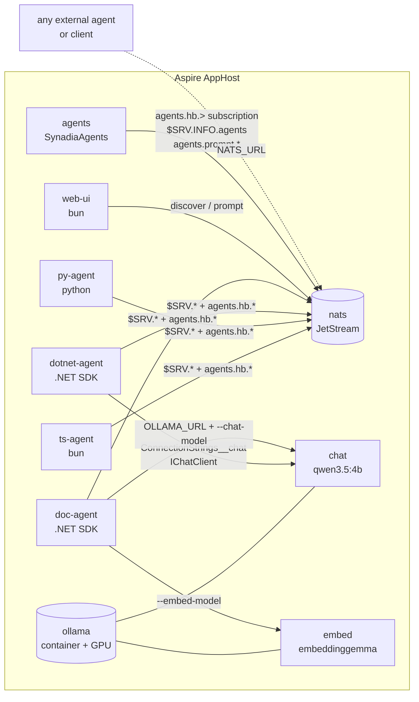

# Aspire agent fleet — Synadia Agent Protocol for NATS

> **Experimental, not published.** A runnable .NET Aspire AppHost for the
> [Synadia Agent Protocol for NATS](https://github.com/synadia-ai/synadia-agent-sdk-docs), built on the
> (unpublished) hosting library in [`integrations/aspire/`](../../integrations/aspire/). The library's README
> documents the API and the `agents` dashboard resource; this example shows it running a whole fleet.

A single `aspire run` brings up a complete local agent fleet:

| Resource | What it is | How it's launched |
| --- | --- | --- |
| `nats` | NATS server 2.14 with JetStream, password-protected, random host port | `Aspire.Hosting.Nats` (`AddNats().WithJetStream()`), container |
| `agents` | **Protocol-level view of the fleet.** Lists live agent instances as nested rows and offers Discover / Status / Prompt / Connect commands | `AddSynadiaAgents()` ([hosting library](../../integrations/aspire/#the-agents-resource)) |
| `ts-agent` | TypeScript reference agent → `demo-agent/aspire/example` | `AddTypeScriptAgent()` → bun |
| `py-agent` | Python reference agent → `py-demo-agent/aspire/python` | `AddPythonAgent()` → `.venv` python |
| `dotnet-agent` | **.NET agent** → `dotnet-agent/aspire/ollama`: Synadia .NET SDK `AgentService.ServeChatClient(IChatClient)` over the `chat` model, with OTel | `AddDotNetAgent<TProject>()` → .NET project, `.WithReference(chat)` |
| `doc-agent` | **.NET document-extraction agent** → `docs/aspire/main` ([`../dotnet-document-agent`](../dotnet-document-agent/)): PDF / image / text attachments → markdown, and questions answered over an in-memory index (`chat` + `embed` models) | `AddDotNetAgent<Projects.DocumentExtraction_Host>()` |
| `ollama` | Ollama server: `ollama/ollama` container with a data volume and NVIDIA GPU (default), or the Ollama already running on the host (`Ollama:Mode=host`) | `AddOllama()` ([CommunityToolkit.Aspire.Hosting.Ollama](https://aspire.dev/integrations/ai/ollama/ollama-get-started/)) |
| `chat` | Model `qwen3.5:4b` (child of `ollama`); pulled on first start, Healthy once available | `ollama.AddModel("chat", …)` |
| `embed` | Model `embeddinggemma` (child of `ollama`), for the doc agent's index | `ollama.AddModel("embed", …)` |
| `web-ui` | Browser test client ([`../agent-web-ui`](../agent-web-ui/)) | `AddBunApp()` (CommunityToolkit) |

Every process gets `NATS_URL` (with credentials) injected, and waits for NATS to be healthy. .NET projects also get `ConnectionStrings__nats`, which `Aspire.NATS.Net`'s `AddNatsClient("nats")` consumes. `dotnet-agent` gets `ConnectionStrings__chat` (`Endpoint=http://…;Model=qwen3.5:4b`), which `CommunityToolkit.Aspire.OllamaSharp`'s `AddOllamaApiClient("chat")` consumes.



Dashboard resource tree:

```
nats
└─ agents                              Healthy (4 alive / min 4)
   ├─ demo-agent-aspire-example        Alive   source: demo-agent/aspire/example
   ├─ docs-aspire-main                 Alive   source: docs/aspire/main
   ├─ dotnet-agent-aspire-ollama       Alive   source: dotnet-agent/aspire/ollama
   └─ py-demo-agent-aspire-python      Alive   source: py-demo-agent/aspire/python
ollama                                 Healthy (container, GPU)
├─ chat                                Healthy (qwen3.5:4b)
└─ embed                               Healthy (embeddinggemma)
doc-agent / dotnet-agent / py-agent / ts-agent / web-ui   Running
```

## Quickstart

Prerequisites: .NET 10 SDK, Aspire CLI (13.5+), Docker, `bun`, `uv` (or Python 3.11+). The .NET agents need nothing extra by default: Aspire runs Ollama in a container and pulls the models. For GPU speed, Docker needs NVIDIA GPU access (Docker Desktop + WSL2 on Windows, or the NVIDIA Container Toolkit on Linux); otherwise pass `-- --Ollama:Gpu=false` (CPU, slow) or `-- --Ollama:Mode=host` (see [Ollama](#ollama-the-community-toolkit-integration)). To skip the .NET agents, pass `-- --Fleet:DotNetAgent=false --Fleet:DocumentAgent=false`.

> **First run downloads about 10 GB:** the `ollama/ollama` image (~5.5 GB) and the models (~4 GB) into the `…-ollama-ollama` Docker volume. `prepare.*` pre-pulls the image. `chat` and `embed` show download progress in the dashboard. Later runs reuse the volume and start in seconds.

> `docker` must be on the `PATH` that `aspire run` inherits. If it isn't, `nats` shows **RuntimeUnhealthy** with `exec: "docker": executable file not found in %PATH%` in its console log.

```powershell
# one-time: build both TS SDKs + web UI, restore the doc agent, create agent-sdk/python/.venv
./examples/aspire-agent-fleet/scripts/prepare.ps1   # or: ./examples/aspire-agent-fleet/scripts/prepare.sh

cd examples/aspire-agent-fleet/AgentFleet.AppHost
aspire run                                        # or: dotnet run
```

Open the dashboard link that gets printed. After about 15 seconds, `agents` turns **Healthy** and has four nested agent rows.

Useful flags:
- `aspire run --isolated` gives randomized ports, so it can run alongside other `nats-server`s on the same machine.
- `aspire run --detach` returns control to the terminal; stop the AppHost with `aspire stop`.
- `-- --Fleet:InstallPackages=true` lets Aspire run `bun install` / `uv sync` itself on every start. The default is `false` and expects `prepare.*` to have been run.

| AppHost setting | Default | Effect |
| --- | --- | --- |
| `Fleet:DotNetAgent` | `true` | Adds `dotnet-agent` (and `ollama` + `chat`) |
| `Fleet:DocumentAgent` | `true` | Adds `doc-agent` (and `ollama` + `chat` + `embed`). The project is still built either way, so `prepare.*` must have fetched its packages |
| `Ollama:Mode` | `container` | `container`: `AddOllama()` container + data volume. `host`: use the Ollama already running on this machine |
| `Ollama:Gpu` | `true` | Container mode: `WithGPUSupport()` (NVIDIA). `false` runs on CPU |
| `Ollama:Url` | `http://localhost:11434` | Host mode: the Ollama endpoint |
| `Ollama:ChatModel` / `Ollama:EmbedModel` | `qwen3.5:4b` / `embeddinggemma` | Models behind `chat` / `embed` |
| `Fleet:DocumentAgentProject` | unset | Runs `doc-agent` from a different host `.csproj` (absolute, or repo-relative) instead of the referenced one |
| `Fleet:RawNatsClient` | `false` | `agents` uses the SDK-independent NATS.Net client instead of the .NET SDK |

Build everything here (AppHost, .NET agent, ServiceDefaults and the hosting library) with `dotnet build examples/aspire-agent-fleet/AgentFleet.slnx`. The library's tests live with it: `dotnet test integrations/aspire/Synadia.AI.Agents.Hosting.Aspire.slnx`.

## Driving the fleet: the `agents` resource

`agents` (from [`AddSynadiaAgents`](../../integrations/aspire/#the-agents-resource)) watches heartbeats, discovers agents through the Synadia .NET SDK caller, and has **Discover**, **Status**, **Prompt (smoke)** and **Connect a client** commands. They work from the dashboard, the CLI and the Aspire MCP server. Run these from `AgentFleet.AppHost/`; attachment paths are relative to the repo root (`AttachmentBaseDirectory`):

```powershell
aspire resource agents discover --non-interactive
aspire resource agents status   --non-interactive
aspire resource agents prompt   --prompt "Say hi to the team" --non-interactive
aspire resource agents prompt   --prompt "hi" --agent py-demo-agent --non-interactive
aspire resource agents prompt   --prompt "/extract" --agent docs --attachment examples/dotnet-document-agent/fixtures/fabrikam-q3-report.pdf --non-interactive
aspire resource agents connect  --non-interactive
```

## The .NET agent (`AgentFleet.DotNetAgent`)

```csharp
builder.AddServiceDefaults();                       // OTel: NATS.Net + Microsoft.Extensions.AI sources/meters
builder.AddNatsClient("nats");                      // Aspire.NATS.Net → INatsConnection (NATS.Net 3.3.2)
builder.AddOllamaApiClient("chat")                  // CommunityToolkit.Aspire.OllamaSharp: ConnectionStrings__chat
    .AddChatClient(otel => otel.EnableSensitiveData = captureContent)   // IChatClient + OpenTelemetry
    .UseLogging();
// LLM calls outlive the standard resilience handler (10 s attempt / 30 s total + retries):
builder.Services.AddHttpClient("chat_httpClient").RemoveAllResilienceHandlers()
    .ConfigureHttpClient(c => c.Timeout = TimeSpan.FromMinutes(5));

// OllamaAgentWorker (BackgroundService):
await using var service = new AgentService(nats, new AgentServiceOptions { Agent = "dotnet-agent", Owner = "aspire", Name = "ollama", ... })
    .ServeChatClient(chatClient, new ChatClientServeOptions
    {
        Instructions = "...",
        ChatOptions = new() { RawRepresentationFactory = _ => new ChatRequest { Think = false } },
    });
await service.StartAsync(ct);
```

Each prompt then produces one dashboard trace, `agents.prompt receive` → `chat qwen3.5:4b` (GenAI semantic conventions: model, tokens, time-to-first-chunk and, in this demo, the messages) → `POST /api/chat`, followed by the streamed `inbox publish` chunks.

## Ollama: the Community Toolkit integration

The AppHost uses [`CommunityToolkit.Aspire.Hosting.Ollama`](https://aspire.dev/integrations/ai/ollama/ollama-get-started/) (and `CommunityToolkit.Aspire.OllamaSharp` in the .NET agent) rather than a hand-rolled external service:

- **Models are resources.** `chat` and `embed` appear in the dashboard under `ollama`. They show "Downloading N percent" while pulling, turn Healthy once the model is available, and have Redownload / Delete / Model info / Stop commands. Consumers `WaitFor(chat)`, so no agent starts before its model exists.
- **One connection string.** Consumers get `ConnectionStrings__chat=Endpoint=…;Model=…`; the client integration builds the `IChatClient` (with OTel) from it. No URL or model name is hard-coded in the agent.
- **Zero prerequisites.** A fresh machine with Docker runs the full fleet, without installing Ollama or pulling models by hand. The data volume keeps the models across runs.
- **GPU.** `WithGPUSupport()` passes the NVIDIA GPU into the container. Verified on Windows with Docker Desktop (WSL2): the container log shows CUDA on the laptop's RTX 3080 (16 GiB), and warm answers come back in 1–3 s.

**Container mode is the default** (`Ollama:Mode=container`). **Host mode** (`Ollama:Mode=host`) uses the Ollama already running on this machine (`Ollama:Url`), for machines where Docker has no GPU access, or to skip the first-run image and model downloads. It keeps the same resource names and connection-string shape (`AddConnectionString("chat", "Endpoint=…;Model=…")` parented under an `ollama` external service), so agent code has one path. In host mode, `chat` / `embed` are health-checked against `/api/tags`: an unpulled model shows Unhealthy with "run `ollama pull <model>`", and its consumers stay Waiting.

`AddOllamaLocal` (the toolkit's executable mode) wasn't used: it starts a second `ollama serve`, which collides with an Ollama already listening on 11434.

The document agent's host isn't modified. The AppHost maps the model resources onto its existing contract: `OLLAMA_URL` = the `ollama` endpoint (`ReferenceExpression`), `--chat-model` / `--embed-model` = the model names, plus `WaitFor(chat)` and `WaitFor(embed)`.

**Gotcha: resilience handlers vs. LLM calls.** The client integration resolves its `HttpClient` from `IHttpClientFactory` (named `chat_httpClient`), so ServiceDefaults' `AddStandardResilienceHandler` applies to it: a 10 s attempt timeout, 30 s total, and retries. A cold model load exceeds that, and the retries queue extra generations on Ollama, which stalls other agents too. The .NET agent removes the handlers for that client and sets a 5-minute timeout (`RemoveAllResilienceHandlers`, experimental `EXTEXP0001`).

## Layout

```
AgentFleet.AppHost/         the fleet (AppHost.cs; HostOllama.cs = host-mode Ollama resources)
AgentFleet.DotNetAgent/     .NET agent: ServeChatClient over the `chat` model
AgentFleet.ServiceDefaults/ OTel/health/resilience defaults (Aspire template + NATS/GenAI sources)
scripts/prepare.{ps1,sh}    one-time setup
DEMO.md                     step-by-step demo script
AgentFleet.slnx             the three projects above + ../../integrations/aspire/src (hosting library)
```

The AppHost references the hosting library (`../../integrations/aspire/src/...`, `IsAspireProjectResource="false"`), the .NET SDK (`../../agent-sdk/dotnet`, via the .NET agent) and its sibling `../dotnet-document-agent` host. The TS and Python agents run from `client-sdk/typescript` and `agent-sdk/python`, and the browser client from `examples/agent-web-ui`, all resolved from the repo root.

## Verified evidence (Windows, Aspire CLI 13.5.3, AppHost SDK 13.6.5)

### Ollama integration (container mode, default)

`aspire run --isolated`, first run on an empty volume: `chat` and `embed` showed "Downloading N percent" (embeddinggemma about 1 min, qwen3.5:4b about 3 min), then every resource was Running/Healthy: `ollama` (container `ollama/ollama:0.34.4`, CUDA on the RTX 3080 Laptop GPU), `chat`, `embed`, `nats`, `agents`, the four agents and `web-ui`.

- `aspire resource agents discover`: 4 agent instances.
- `prompt --agent dotnet-agent/aspire/ollama`: answered in 2.7 s.
- `prompt "/extract" --agent docs --attachment …fabrikam-q3-report.pdf`: markdown in 5.4 s.
- `prompt "What was Fabrikam's Q3 revenue?" --agent docs --attachment …`: "Fabrikam's Q3 2025 revenue was $3.1 million", 1.4 s (warm).
- Trace: `chat qwen3.5:4b` (source `dotnet-agent`, destination `chat`, 557 ms, `gen_ai.*` attributes and token usage) → `POST http://localhost:<port>/api/chat`.

Host mode (`Ollama__Mode=host`): `ollama` is an external service, `chat` / `embed` are connection strings under it. All Healthy, 4 agents discovered, `dotnet-agent` answered in 10.8 s and the RAG question in 12.7 s (cold host Ollama). With `Ollama__ChatModel=not-pulled:1b`, `chat` was Unhealthy ("Model 'not-pulled:1b' is not pulled on http://localhost:11434; run `ollama pull not-pulled:1b`") and `dotnet-agent` stayed Waiting.

> Phase 2–3 evidence below predates the Ollama integration; Ollama was then the host process on `localhost:11434`.

### Phase 3: document-extraction agent

`aspire describe`: every resource is Running/Healthy, including `doc-agent` (the `DocumentExtraction.Host` project, built in the AppHost graph).

`aspire resource agents discover`: **4 agent instances**, `demo-agent/aspire/example`, `docs/aspire/main`, `dotnet-agent/aspire/ollama` and `py-demo-agent/aspire/python`. `status`: all four `✅ ok` (the doc agent heartbeats every 30 s, the others every 5 s).

`aspire resource agents prompt --prompt "/extract" --agent docs --attachment examples/dotnet-document-agent/fixtures/fabrikam-q3-report.pdf`:

```
> /extract
  📎 fabrikam-q3-report.pdf (application/pdf, 2,564 bytes)
│ docs/aspire/main │ ✅ terminated │ 7 │ 1.37s │
status: ack → extracting fabrikam-q3-report.pdf (2.5 KB) with PdfPig → page 1/2 → page 2/2

# Fabrikam Widgets - Q3 2025 Report
Fabrikam Widgets sold 48,200 units in Q3 2025, up 12% from Q2. ...
## Regional sales
| Region | Units | Revenue | Growth |
| North  | 18,400 | $1.20M | +15% |   ... (South, East, West)
## Shipping and returns policy ...
## Outlook ...
```

The same PDF with a question, `--prompt "Which region grew fastest in Q3, and what is the Q4 unit forecast?"`:

```
│ docs/aspire/main │ ✅ terminated │ 9 │ 11.36s │
status: ack → indexing fabrikam-q3-report.pdf with PdfPig → indexed: 2 page(s), 4 chunk(s) → searching documents → answering
- Fastest Growing Region: The North region had the highest growth rate at +15% (source: fabrikam-q3-report.pdf).
- Q4 Unit Forecast: Fabrikam expects to sell 55,000 units in Q4 2025 (source: fabrikam-q3-report.pdf).
```

The attachment travels as MEAI `DataContent` on the dashboard's `Agent.AsIChatClient()` call, goes over NATS as a protocol §5.2 attachment, and is served by the doc agent's `ServeChatClient(DocumentAgentChatClient)`. So both ends use the .NET SDK's MEAI adapters.

### Phase 2: .NET agent and SDK client

`aspire describe`: every resource is Running/Healthy (`agents`, `dotnet-agent`, `nats`, `ollama`, `py-agent`, `ts-agent`, `web-ui`).

`aspire resource agents discover` (via the .NET SDK `AgentsClient`):

```
│ demo-agent    │ aspire │ example │ —       │ 0.3 │ 0.0.1 │ agents.prompt.demo-agent.aspire.example   │
│ dotnet-agent  │ aspire │ ollama  │ —       │ 0.3 │ 0.1.0 │ agents.prompt.dotnet-agent.aspire.ollama  │
│ py-demo-agent │ aspire │ python  │ python  │ 0.3 │ 0.5.0 │ agents.prompt.py-demo-agent.aspire.python │
```

`aspire resource agents status`: all three agents report `✅ ok`, `interval_s: 5`.

`aspire resource agents prompt --prompt "In one sentence, what is NATS?" --agent dotnet-agent/aspire/ollama`:

```
│ dotnet-agent/aspire/ollama │ ✅ terminated │ 45 │ 14.08s │   (cold model load)
status: ack
NATS ... is an ultra-high-performance open-source messaging platform designed for low-latency data exchange ...
```

`aspire resource agents prompt --prompt "ping"` (all agents):

```
│ demo-agent/aspire/example   │ ✅ terminated │ 1  │ 0.02s │
│ dotnet-agent/aspire/ollama  │ ✅ terminated │ 24 │ 2.99s │  → "Pong! 🟢 All green, Aspire running smoothly on NATS…"
│ py-demo-agent/aspire/python │ ✅ terminated │ 2  │ 0.01s │
```

The dashboard trace for that prompt has the spans `agents.prompt receive` (NATS consumer) → `chat qwen3.5:4b` (2973 ms; `gen_ai.provider.name=ollama`, 107 in / 26 out tokens, time to first chunk 1.57 s) → `POST http://localhost:11434/api/chat`, followed by 24 `inbox publish` chunk spans. Heartbeats appear as `agents.hb publish` spans.

The TS SDK `01-discover.ts`, run against the same NATS, finds all three agents, including `dotnet-agent/aspire/ollama` ("`.NET agent (AgentService.ServeChatClient) backed by Ollama qwen3.5:4b`"). So the TS, Python and .NET SDKs interoperate.

### Phase 1
`aspire describe`:

```
│ agents   │ SynadiaAgents │ Running    │ Healthy │ -                      │
│ nats     │ Container     │ Running    │ Healthy │ tcp://localhost:55105  │
│ py-agent │ Executable    │ Running    │ Healthy │ -                      │
│ ts-agent │ Executable    │ Running    │ Healthy │ -                      │
│ web-ui   │ Executable    │ Running    │ Healthy │ http://localhost:55106 │
│ *-installer │ Executable │ NotStarted │ -       │ -                      │
```

`aspire resource agents discover`:

```
│ Agent         │ Owner  │ Name    │ Session │ Protocol │ Harness │ Prompt subject                            │
│ demo-agent    │ aspire │ example │ —       │ 0.3      │ 0.0.1   │ agents.prompt.demo-agent.aspire.example   │
│ py-demo-agent │ aspire │ python  │ python  │ 0.3      │ 0.5.0   │ agents.prompt.py-demo-agent.aspire.python │
```

`aspire resource agents prompt --prompt "Say hi to the team"`:

```
│ demo-agent/aspire/example   │ ✅ terminated │ 1 │ 0.01s │   → "demo agent received your prompt."
│ py-demo-agent/aspire/python │ ✅ terminated │ 2 │ 0.01s │   → "status: ack" / "echo: Say hi to the team"
```

The TS SDK example against the Aspire NATS (`NATS_URL` from **Connect a client**), `bun run examples/01-discover.ts`:

```
found 2 agent(s):
  py-demo-agent/aspire/python   protocol_version: 0.3  version: 0.5.0
  demo-agent/aspire/example     protocol_version: 0.3  version: 0.0.1
```

Other checks:
- **Web UI.** At `web-ui`'s URL, both agents are listed and chat works.
- **External agent.** I started a TS reference agent outside Aspire with `USER=guest`. `demo-agent/guest/example` appeared as **Alive** under `agents` within one heartbeat. After I killed it, it went **Stale** ("last heartbeat 38s ago") and `agents.alive` dropped from 3 to 2.
- **Unit tests.** `dotnet test`: 24/24 passed (27 today).

## NATS.Net version note

`Aspire.NATS.Net` 13.6.5 works with NATS.Net 3.3.2 (its floor is `≥ 2.8.2`); details in the [hosting library README](../../integrations/aspire/#natsnet-version-note).

## Caveats

- **Telemetry.** `dotnet-agent` emits NATS and GenAI traces, metrics and logs through ServiceDefaults. `doc-agent` (no ServiceDefaults yet) and the TS and Python reference agents don't emit OpenTelemetry; for them, the dashboard shows console logs, the `agents` heartbeat log and command results. They already get the Aspire OTLP env vars, so they will light up once they add OTel.
- **Doc agent's own TS caller.** `examples/dotnet-document-agent/callers/ts/extract-pdf.ts` passes `NATS_URL` straight to `@nats-io/transport-node`, which rejects the credentialed URL Aspire's NATS uses (`nats://nats:<pw>@host:port`). Use the Prompt command (above) instead; the repo's TS SDK examples (`client-sdk/typescript/examples/_connection.ts`) do honor URL credentials.
- **Prompt content in traces.** The sample sets `GENAI_CAPTURE_CONTENT=true`, which records prompts and replies on GenAI spans. Turn it off for anything that isn't a demo.
- **Installer rows.** `*-installer` resources (NotStarted) appear because the JS/Python integrations always model an installer. They only run with `Fleet:InstallPackages=true`.
- **`uv sync` and private networks.** If `uv sync` can't reach PyPI, `prepare.*` falls back to `python -m venv` + `pip install -e`.
- The Python reference agent needed a small Windows fix (no `loop.add_signal_handler` on Windows). It is included in this repo: `agent-sdk/python/examples/_reference_agent.py`.

## The document-extraction agent

The sibling example [`../dotnet-document-agent`](../dotnet-document-agent/) (`src/DocumentExtraction.Host`) is referenced by the AppHost and runs as `doc-agent`:

```csharp
builder.AddDotNetAgent<Projects.DocumentExtraction_Host>("doc-agent", nats)   // NATS_URL (+ ConnectionStrings__nats)
       .WithArgs("--owner", "aspire", "--name", "main", "--chat-model", chatModel, "--embed-model", embedModel)
       .WithEnvironment("OLLAMA_URL", ollamaUri)          // the `ollama` resource's endpoint
       .WaitFor(chat).WaitFor(embed);
```

- The host reads `NATS_URL` and `OLLAMA_URL` from the environment. Models are command-line arguments only. It registers `docs/<owner>/<name>` and serves `ServeChatClient(DocumentAgentChatClient)`.
- Send `/help` for usage. `/extract` + attachment returns markdown; a question + attachment indexes the file, then answers with sources; `/ingest` indexes without answering.
- Its `CommunityToolkit.DocumentExtraction.PdfPig` / `VisionLanguageModel` `1.0.0-preview` packages come from nuget.org. `prepare.*` restores the host from its own directory, then the AppHost graph restores from the global package cache.
- `--Fleet:DocumentAgent=false` removes the resource. `--Fleet:DocumentAgentProject=<csproj>` swaps in a different host (same arguments and environment).

## Status

- ✅ **Phase 1.** NATS + TS and Python reference agents + web UI; the `agents` resource with Discover / Status / Prompt / Connect.
- ✅ **Phase 2.** The .NET agent (`ServeChatClient` over Ollama, with OTel). `agents` discovers, gets status and prompts through the .NET SDK caller, with raw NATS.Net as an option. `AddDotNetAgent` helpers.
- ✅ **Phase 3.** The document-extraction agent runs as `doc-agent` (on by default). The Prompt command can send a file attachment.
- ✅ **Ollama integration.** `AddOllama()` + `AddModel()` (container with GPU by default, host mode as a flag); the .NET agent uses `AddOllamaApiClient("chat").AddChatClient()`.

## Troubleshooting

- **NuGet restore can't find `CommunityToolkit.Aspire.*`.** Your NuGet config must include nuget.org (or a mirror of it). If a machine-wide `nuget.config` maps everything to an internal feed, restore once with a config that adds nuget.org; the packages then come from the global cache.
- **`ollama` container is slow or doesn't start on the GPU.** Check `docker run --rm --gpus all nvidia/cuda:12.4.0-base-ubuntu22.04 nvidia-smi`. Without GPU access, use `-- --Ollama:Mode=host` or `-- --Ollama:Gpu=false`.
- **First prompt after a fresh model download times out.** Loading the model into the GPU the first time can take 1–2 minutes, longer than the Prompt command's 90 s `PromptTimeout`. The agent still finishes; retry and later prompts answer in seconds.
- **Moving or renaming the AppHost re-downloads the models.** The data volume name includes a hash of the AppHost path (`agentfleet.apphost-<hash>-ollama-ollama`). Remove the old volume afterwards.
- **Free the disk space.** The models live in a Docker volume (`docker volume ls | findstr ollama`); `docker volume rm <name>` removes them.